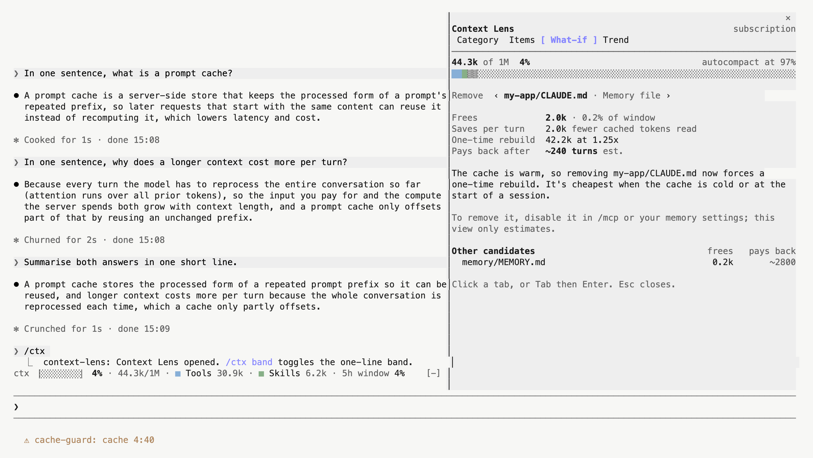
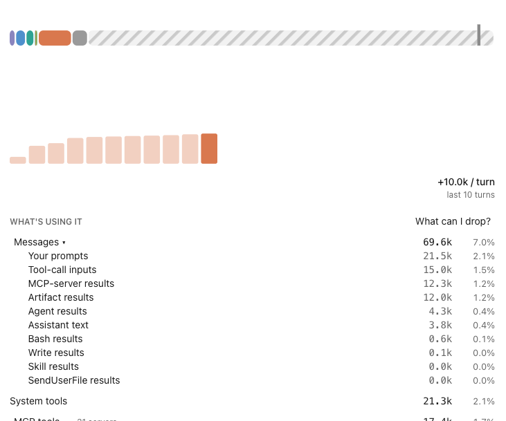

# claude-mods

Three mods for [Claude Code](https://claude.com/claude-code). A *mod* is a plugin that changes Claude Code's own screen and behaviour: it can add a side panel, a line above the prompt box, or a short note the model reads after a tool runs.

| Mod | What it tells you | Opens with |
|---|---|---|
| **[Context Lens](#context-lens)** | What is filling the context window, and what carrying it costs every turn | `/ctx` |
| **[Cache Guard](#cache-guard)** | When the prompt cache is about to expire, and what the next turn costs if it does | `/cache` |
| **[Lessons](#lessons)** | When Claude is stuck in a loop, and which repeated mistakes are worth a standing rule | `/lessons` |

Each mod works on its own; install any one of them, or all three.


## Requirements

- Claude Code **2.1.325 or newer**. Mods are an early-access feature, so their API can change between releases. Check your version with `claude --version`.
- Works in the terminal and in the desktop app's Code tab. The terminal is the most tested.

## Install

In Claude Code, run one line per mod you want:

```
/plugin install context-lens --marketplace Rohitp/claude-mods
```

```
/plugin install cache-guard --marketplace Rohitp/claude-mods
```

```
/plugin install lessons --marketplace Rohitp/claude-mods
```

The first time, Claude Code asks whether to add the `Rohitp/claude-mods` marketplace (the list of plugins in this repository): answer `y`. Then pick a scope: *user* installs it for every project, *project* only for the current one. Start a new session and the mod is running.

To turn a mod off without removing it, use `/plugin` and disable it. To remove it: `/plugin uninstall lessons` (or the mod's name).

---

## Context Lens

The *context window* is everything the model reads on each turn: the system prompt, tool definitions, your `CLAUDE.md` memory files, MCP server instructions, and the conversation so far. When it fills up, Claude Code *autocompacts*: it replaces the conversation with a summary. A full window is also more expensive, because every turn re-reads all of it.

Context Lens shows what is in the window, says so at the moment something large lands, and stays quiet otherwise.

- **A line under big tool results.** When one tool call adds 10k tokens or more, a line appears under it, such as `+42k context · 4.2% of window`.
- **Cards at 80%, 90%, and just before autocompact.** A card appears in the conversation saying how many turns are left and how much compacting would free, with **Compact now** and **Not now**. Each level shows once; after a compaction they start again.
- **The working line.** From 70% full, the animated line shown while Claude works adds the fill, such as `· 84% context`.
- **The band** is a one-line row above the prompt box: a stacked bar, the percent used and the biggest categories. It appears from 80% full. `/ctx band on` keeps it up all the time, `/ctx band off` hides it, `/ctx band auto` restores the default. Its **×** hides it for the session.
- **The panel** (`/ctx`) has four tabs:
  - **Category:** tokens per category (tools, memory files, messages…) and each one's share of the window.
  - **Items:** each memory file, MCP server, skill and agent, and the conversation split by source.
  - **What-if:** what removing one memory file or MCP server would free, and after how many turns that pays back. Removing something changes the start of the prompt, so the next turn costs more once while the prompt cache is rebuilt.
  - **Trend:** fill per turn, how fast it is growing, and turns left until autocompact.



In the desktop app the panel is one list: the window as a bar, fill over the last ten turns, and every category, which opens to its items.



**Try it:** run `/ctx`. A panel opens with the Category tab selected and your current fill at the top, such as `44.3k of 1M 4%`. Press Tab to move between tabs, Enter to pick one, Esc to close.

## Cache Guard

Claude Code uses a *prompt cache*: the start of the prompt, which repeats every turn, is stored by the API so the next turn can re-read it cheaply (about a tenth of the normal input price). The cache expires after a fixed idle time, its *TTL* (time to live): usually 5 minutes. If you step away longer, the next turn pays full price to write the whole prompt again.

Cache Guard counts down to that expiry.

- **A warning 60 seconds before expiry:** a short pop-up and a band above the prompt box showing what a miss would cost.
- **After it expires:** the band says the next turn rewrites everything anyway, which makes it the cheapest moment to compact.
- **The panel** (`/cache`): the countdown, the cost of a miss against a keep-alive ping, recent cache hits and misses, and a log of what invalidated the cache: going idle past the TTL, switching model, switching effort, or a compaction.
- **Keep warm** (`/cache warm`): sends a small request shortly before expiry so the cache stays alive. It is off until you turn it on. It turns itself off once another ping would cost more than the miss it prevents (counting everything a ping costs, its output included), after 2 hours with no turn from you, or if a ping fails. Each ping is a real model request and is billed as one.

Claude Code doesn't report the TTL, so Cache Guard assumes 5 minutes. `/cache 1h` switches it to one hour, `/cache 5m` back. `/cache stats` compares that assumption with the idle gaps it has actually seen and says if the other setting fits better.


In the last minute, its band sits above Context Lens's:


**Try it:** send any message, then run `/cache`. The panel shows a countdown starting near `5:00`. Leave the session idle; at `1:00` a pop-up appears and the countdown turns amber.

## Lessons

Lessons watches tool calls for loops while they happen, gives the model one short note to break out of them, and offers to turn repeated mistakes into one-line rules. Nothing is written to your files until you accept.

**Loops it catches.** On the third step of a loop, the model gets a one-line note after the tool result telling it to change approach, and you see a pop-up:

| Loop | Example |
|---|---|
| The same call failing the same way | `cat missing.txt` three times |
| One command re-run with bigger limits | `grep … \| head -50`, then `-200`, then `-500` |
| The same error from different commands | `tsc`, `npm run build` and `pnpm tsc` all failing on one type error |
| Edits that undo each other | `x = 1` → `x = 2` → `x = 1` → `x = 2`, or writing a file back to an earlier version |
| A failure that survives each fix | run tests, edit, same failure, edit, same failure (timings and line numbers are ignored when comparing) |
| Re-reading a file that hasn't changed | the same part of a file read three times. An edit, a shell command that names the file, or a compaction resets the count |

A tool call gets at most one loop note, so overlapping loops don't stack, and a loop that goes quiet for 10 tool calls ends. Set the `liveHints` option to `false` to keep the pop-ups and the record but send the model no loop notes.

**The panel** (`/lessons`) has four tabs:

- **Proposals:** each repeated mistake as a one-line rule, with the evidence, the tokens it wasted (measured this session), what the rule would cost to carry (estimated), and the difference. A rule that would cost more than it saves is dimmed and says so. Accept it one of two ways:
  - *Just in time:* the rule is shown to the model only when a matching tool call runs, at most twice a session. Cheapest.
  - *Always on:* the rule is written to `CLAUDE.local.md`, a personal memory file Claude Code reads every turn, between marker comments so Lessons can update it. Costs tokens every turn.

  **Undo** works until your next message. **Not useful, dismiss** hides a proposal for good, in later sessions too.
- **Active:** accepted rules, how often each was shown, and whether the mistake came back anyway.
- **Loops:** this session's loops, with the exact note the model received.
- **Memory:** lines in the project's `CLAUDE.md` files that look stale (they name a path that no longer exists), never used, or in use, with what each costs per turn. **Remove** keeps a copy so you can undo it.

`/lessons accept <id>` (add `always` for always-on) and `/lessons retire <id>` work without opening the panel. Both run only when you type them, never when the model or another plugin sends them. **Reword with Claude** asks a model to tighten a rule's wording; it is the only Lessons feature that sends anything to a model, and it asks first.

Here is the Proposals tab after Claude re-read one file five times, drawn by the mod's own renderer:

```
Lessons                                            subscription · tokens
[ Proposals 2 ] [ Active 0 ] [ Loops 2 ] [ Memory 0 ]
────────────────────────────────────────────────────────────────────────
Claude repeated these this session. Nothing changes until you choose.

[−] ↻ Read the same file 5 times                                   +4.4k
      researcher.md · …/skills/deep-research/references · turn 1

    Claude read researcher.md 5 times and it never changed in between.
    Every read after the first re-sent about 1.1k tokens it already had.

    ┌ suggested rule ──────────────────────────────────────────────────┐
    │ Don't re-read researcher.md unless it changed; use what was      │
    │ already read.                                                    │
    └──────────────────────────────────────────────────────────────────┘
    wasted 4.4k measured · rule costs 38 · worth it +4.4k

    What happened · 5× in turn 1
    t1  Read  …/deep-research/references/researcher.md  → unchanged  ×3
    + 2 more like these
```

**Try it:** in any project, ask Claude:

> Run these as three separate Bash calls even though they fail: `cat /tmp/nope.txt`, `head /tmp/nope.txt`, `tail /tmp/nope.txt`.

After the third call a pop-up appears, starting `Caught a loop`. Run `/lessons` and open the Loops tab: the loop is listed as a *same-error loop*, with the exact note the model received.

---

## Settings

Each mod has a few options. Set them in `~/.claude/settings.json` under `pluginConfigs`, then start a new session:

```json
{
  "pluginConfigs": {
    "lessons@claude-mods": { "options": { "liveHints": false } },
    "context-lens@claude-mods": { "options": { "openOnStart": "widget" } }
  }
}
```

| Mod | Option | Default | What it does |
|---|---|---|---|
| Context Lens | `openOnStart` | `off` | `pane` opens the panel in every session; `widget` opens its small form in the desktop app (the full panel elsewhere). In the terminal it opens only when the window is wide enough for a side panel. |
| Context Lens | `metrics` | `true` | Keeps local counters so `/ctx stats` can report how accurate its estimates were. |
| Cache Guard | `metrics` | `true` | Keeps local counters so `/cache stats` can check the TTL assumption. |
| Lessons | `liveHints` | `true` | `false` stops the loop notes to the model; loops are still recorded and shown, and rules you accepted still apply. |

## How the numbers are worked out

- **Billing is detected for you.** With API billing, costs are shown in dollars and marked *est.* With a subscription you see tokens and your 5-hour usage window instead. For a model the mods don't have a price for, you see tokens only.
- **Costs are estimates.** Prices come from a small table built into each mod. The split of the conversation by source is estimated from text length, then scaled to match Claude Code's own total.
- **Lessons measures waste and estimates carry.** *Saved* counts the output tokens the loop actually produced more than once. *Carry* estimates what the rule costs in tokens each time it is shown.
- **Cache causes are best effort.** A cache miss Cache Guard can't explain is shown as *cause unknown*.

## Privacy

- **Nothing leaves your machine** except the model requests you turn on: Cache Guard's keep-warm pings, and Lessons' **Reword with Claude**, which sends only the rule and its evidence after you confirm.
- **What is stored, and where.** Each mod keeps its data in Claude Code's local plugin store on your computer:
  - Context Lens and Cache Guard: counters, and a short event log of counts and durations. They never store prompt or file content.
  - Lessons, per project: this session's tracked calls (each command or file path, cut to 300 characters, and the first line of any error, with anything that looks like a password, token or API key masked; never file contents), accepted and dismissed rules, and the first word of each command and the folders of files it saw. It uses those to tell whether a `CLAUDE.md` line is still used.
- **What Lessons writes to your files.** Lessons edits `CLAUDE.local.md` only when you accept an *always-on* rule, and edits a `CLAUDE.md` line only when you press **Remove**. Both can be undone. Remove only touches instruction files inside the project, never the files they `@`-import, and does nothing if the file changed after you looked at it.
- **What the model is told.** A Lessons note names the commands or the file involved; it never repeats a tool's output to the model.
- **Debug output.** Debug lines (counts, ids and durations) go to `claude --debug` only.

## Development

```
npm install
```

```
npm test
```

```
claude plugin test ./lessons
```

```
claude plugin validate ./lessons --profile directory
```

`npm test` runs all three mods' tests with a small local runner. `claude plugin test` runs one mod's tests the way Claude Code loads it, and `claude plugin validate … --profile directory` runs the checks the plugin directory applies to a submission. Swap `lessons` for `context-lens` or `cache-guard` to check the others. To run Claude Code with your local copies instead of the installed ones:

```
claude --plugin-dir ./context-lens --plugin-dir ./cache-guard --plugin-dir ./lessons
```

`scripts/make-icons.py` redraws the three listing icons.

## License

[MIT](LICENSE)
