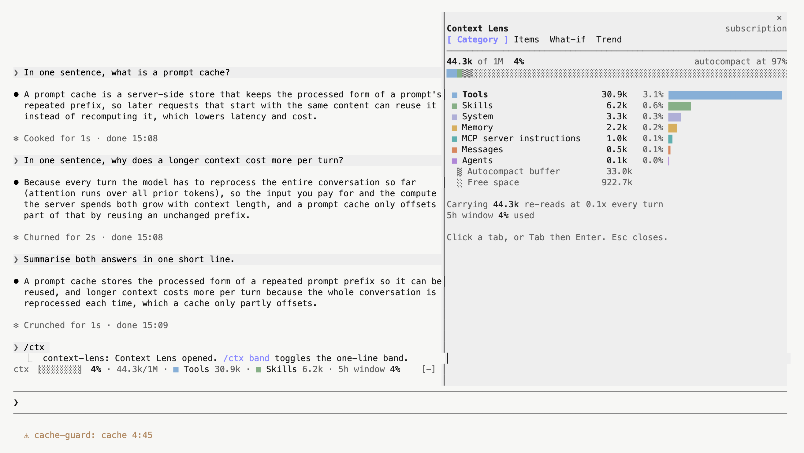
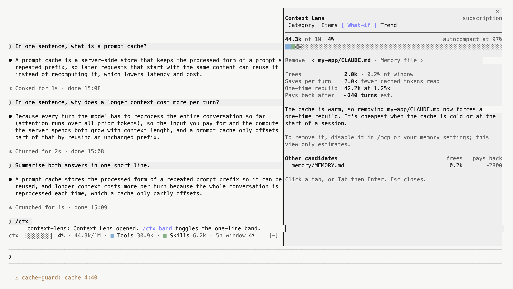
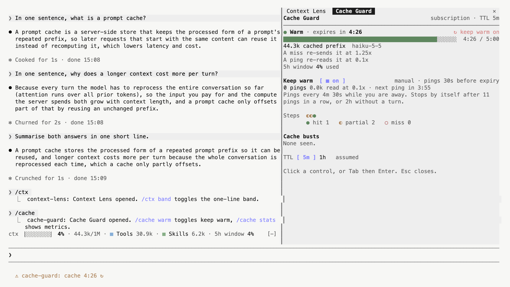
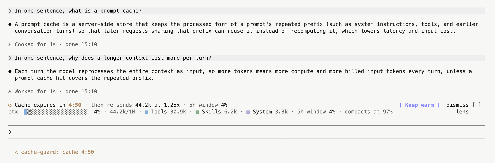
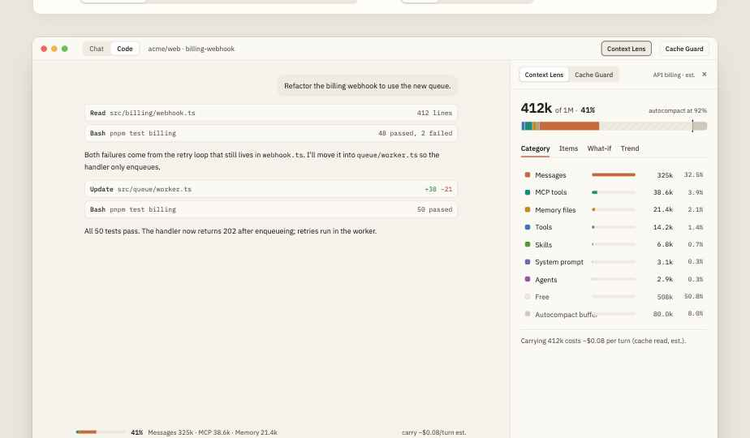
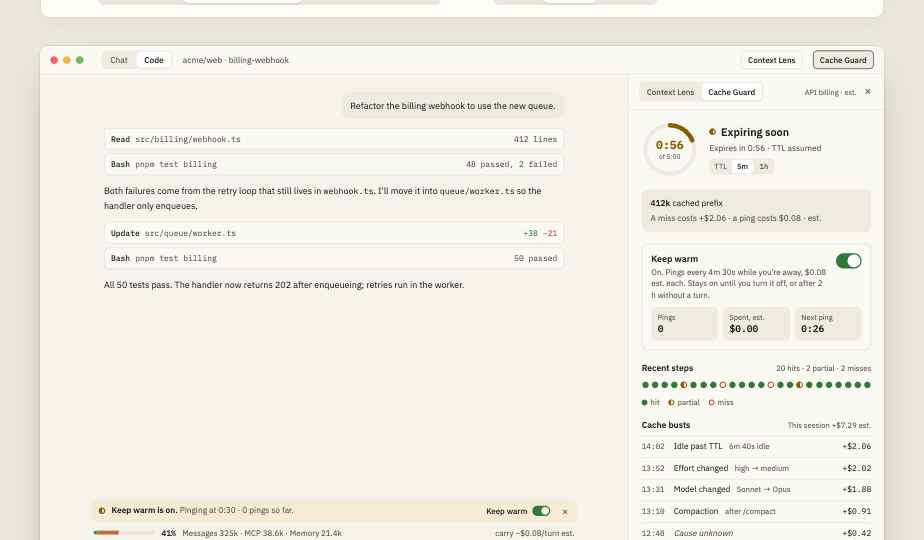

# claude-mods

Three small mods for Claude Code: what fills your context window, when your prompt cache is about to go cold, and which repeated mistakes are worth a rule.

| Mod | Answers |
|---|---|
| **context-lens** | What is using my context window, and what does carrying it cost? |
| **cache-guard** | When does my prompt cache expire, and what will the next turn cost if it does? |
| **lessons** | What keeps going wrong in my sessions, and is a rule for it worth what it costs to carry? |



## Install

```
/plugin install context-lens --marketplace Rohitp/claude-mods
/plugin install cache-guard  --marketplace Rohitp/claude-mods
/plugin install lessons      --marketplace Rohitp/claude-mods
```

Answer `y` to add the marketplace, then choose a scope. To try them from a checkout instead:

```
claude --plugin-dir ./context-lens --plugin-dir ./cache-guard --plugin-dir ./lessons
```

Needs a Claude Code build with mod support (written against 2.1.296).

## Context Lens

A one-row band above the prompt and a side panel opened with `/ctx`.

- **Band:** a stacked bar, percent used, the biggest categories, and what carrying the context costs each turn. From 80% it estimates the turns left before autocompact and adds a **Compact now** button.
- **Compact offer:** from 80%, a row above the band says what compacting would free (an estimate: messages shrink to a summary), what that saves per turn on API billing, and offers **Compact now** or **Not now**. Not now keeps it quiet until the context has grown another 10%.
- **Category:** every category with its tokens and share of the window.
- **Items:** each memory file, MCP server, skill and agent, plus messages split by source.
- **What-if:** an estimate of what removing a memory file or MCP server frees, and how many turns until the one-time cache rebuild pays back.
- **Trend:** window fill per turn, growth rate and turns to autocompact.

`/ctx band` toggles the band.



## Cache Guard

A countdown for the prompt cache, so an idle gap doesn't turn into an expensive full re-send.

- **Warning:** at 60 seconds before expiry you get a note, and a band showing what a miss would cost.
- **When it's cold:** the band says the next turn rewrites everything anyway, which is the cheapest moment to compact.
- **Panel (`/cache`):** countdown, cost of a miss vs a keep-alive ping, recent hits and misses, and a log of cache busts with the cause (idle past the TTL, model change, effort change, compaction).
- **Keep warm:** a manual toggle. It sends a cheap cache-read ping shortly before expiry and stops by itself once another ping would cost more than the miss it avoids, or after 2 hours without a turn. It never turns itself on.

`/cache warm` toggles keep warm; `/cache 5m` or `/cache 1h` sets the TTL it assumes.



The cache band appears above the context band in the last minute before expiry (staged here so it shows at 4:50):



## Lessons

Catches failures, loops and corrections as they happen, and turns each into a one-line rule with a price. Nothing is written until you accept it.

- **Live nudge:** the third identical failure (or the third re-run of a command with a bigger `head -n`) adds one short note after the tool result so the model changes approach, and shows a toast. `liveHints: false` turns the note off.
- **Proposals:** each has the evidence, what it wasted (measured), what it costs to carry, and the net. A rule that costs more than it saves is dimmed and says so.
- **Delivery:** *just in time* shows the rule once per session when a matching call runs again. *Always on* writes it to `CLAUDE.local.md` between markers. Both ask first, and **Undo** lasts until your next turn.
- **Active:** accepted rules, how often they fired, and whether the failure came back.
- **Loops:** this session's loops, the note the model was given verbatim, and waste per session.
- **Memory:** lines in your `CLAUDE.md` files that look stale (a path that no longer exists), never triggered, or in use, with what each costs per turn. Remove keeps a copy so you can undo.
- **Polish wording** is the only thing that calls a model, and asks first. It sends the rule and its evidence, nothing else.

`/lessons` opens the pane; `/lessons accept <id> [always]` and `/lessons retire <id>` work without it.

## Desktop app

The mods also draw for the desktop app. These are the design previews the desktop renderer was built from; it has not been verified in the app yet.




## Good to know

- **Billing mode is detected for you.** On API billing, costs are shown in dollars and marked "est."; on a subscription you get tokens, multipliers and your 5-hour window instead. A model without a known price shows tokens only.
- **The cache TTL is assumed.** Claude Code doesn't report it, so the default is 5 minutes. `/cache stats` compares that assumption with the idle gaps it has actually seen and tells you if `/cache 1h` fits better.
- **Numbers are estimates.** Prices come from a small built-in table, and the per-source message split is estimated from text length and scaled to the engine's own total.
- **Bust causes are best effort.** Anything it can't attribute is shown as "cause unknown".
- **The mod API is early access** and can change between Claude Code releases.

## Privacy

Nothing is sent anywhere unless you switch it on. The mods write debug lines (counts, ids and durations, never prompt or file content) to `claude --debug`, and keep counters and approved rules in their own local store. Set the `metrics` option to `false` to turn the counters off. Lessons also keeps, per project, the first word of the commands and the folders of the files it saw, so it can tell whether a `CLAUDE.md` line is used. The only model requests they make are the keep-warm pings you enable and, in Lessons, **Polish wording** after you confirm what it will send.

## Development

```
npm install
npm test                         # model, layout and rendering tests
claude plugin validate ./cache-guard   # likewise context-lens, lessons
```
